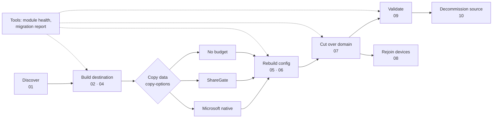

# M365 Tenant-to-Tenant Migration Toolkit

**TL;DR:** Everything I use to move a business from one Microsoft 365 tenant to another, in the order I use it. There's one spine of PowerShell scripts that works whatever moves the data, and three copy options: Microsoft's native cross-tenant migration, ShareGate, or no budget at all. Every script has a README with a TL;DR, why you need it, what goes wrong without it, and the gotchas I hit on a live migration. Built so someone doing their first tenant-to-tenant move can follow it start to finish.

| | |
| --- | --- |
| Author | Mezba Uddin, Microsoft MVP |
| Licence | MIT |
| Came from | A real small-business migration: about 40 mailboxes, 1.7 TB of mail and archives, SharePoint, Teams, OneDrive and three domains |

## The journey

| Phase | Part | What it does | Changes anything? |
| --- | --- | --- | --- |
| Discover | [01 Source inventory](01-SourceInventory/) | Mailbox and archive sizes, permissions, users and licences, groups, lists, contacts, domains, SharePoint and OneDrive, as CSVs | No |
| Build | [02 Target mailboxes](02-TargetMailboxes/) | Builds destination mailboxes from the inventory. Stage as shared, copy, then license and convert | Destination. `-WhatIf` |
| Build | [02b User mapping](02b-UserMapping/) | Reads both tenants and matches every mailbox, list and contact (tag, old address, alias, name). Writes the mapping CSV, a ShareGate `.sgum` and a review list. Without it, one typo puts permissions on the wrong person | No |
| Build | [04 Target OneDrives](04-TargetOneDrives/) | Creates destination OneDrives and reports their URLs | Destination. `-WhatIf` |
| Copy | [Copy options](copy-options/) | [A. Microsoft native](copy-options/A-Microsoft-native/), [B. ShareGate](copy-options/B-ShareGate/), [C. No budget](copy-options/C-No-budget/), with a comparison to help you choose | Depends on option |
| Copy | [03 EWS archive readiness](03-EwsArchiveReadiness/) | If your tool copies archives over EWS: checks and fixes both tenants. Without it, mail copies and every archive fails | Only with `-Fix` |
| Rebuild | [05 Mail config](05-MailConfig/) | Permissions, forwarding, distribution lists and contacts, exported and rebuilt. Without it, shared mailboxes arrive that nobody can open | Destination on import. `-WhatIf` |
| Rebuild | [06 Groups, Teams and sites](06-GroupsTeamsSites/) | Every Microsoft 365 group, Team and SharePoint site exported. Groups created in the destination on your domain, with owners and members, before the copy | Destination on import. `-WhatIf` |
| Copy | [New-DriveCopyList](copy-options/#building-the-onedrive-copy-list-new-drivecopylistps1) | Builds the OneDrive copy list for B and C: leavers into one folder each in an archive library, staff into their new OneDrive, archived OneDrives marked Skip. Creates the folders with `-CreateFolders` | Only with `-CreateFolders` |
| Cut over | [07 Domain cutover](07-DomainCutover/) | DNS record, add in destination first, release from source, verify, old addresses with X500s, sign-in names, temporary passwords. Plus `Test-CutoverReadiness` (go/no-go), `Export-DomainDns -FullScan` and `Set-DomainDnsRecords` (moving DNS hosting), `Add-TargetDomain -WaitForDns`, and `Block-SourceSignIn` | Both tenants, in order. `-WhatIf` |
| Cut over | [08 Devices](08-Devices/) | Planned. Rejoin Entra-joined laptops to the destination: back up the profile, leave, join, Intune, sign the apps back in | n/a yet |
| Validate | [09 Validation](09-Validation/) | Checks the destination against the inventory, plan and mapping: types, licences, archives, item counts, addresses, X500s, OneDrives, list members, the password-change flag, and Conditional Access that will block your test sign-in. Pass, warn and fail report | No |
| Decommission | [10 Decommission](10-Decommission/) | Planned. Block source sign-in, final incrementals, export and retain, unlicensed OneDrives, remove licences, close the tenant | n/a yet |
| Any time | [tools](tools/) | `Test-ModuleHealth` finds the Graph module version clash before it stops a script. `Get-MigrationReport` reads every report CSV and shows what still needs a look, on screen or as one HTML page | No (`-Fix` installs modules) |
| Plan and run | [docs](docs/) | [Discovery questionnaire](docs/Discovery-Questionnaire.md), [cutover runbook](docs/Cutover-Runbook.md), [comms templates](docs/Comms-Templates.md), [risk register](docs/Risk-Register.md), [handover template](docs/Handover-Template.md), [DNS move playbook](docs/DNS-Move-Playbook.md), [lessons learnt](docs/Lessons-Learnt.md) | No |

**08** device rejoin and **10** source decommissioning are written up as plans; their scripts come as the live migration moves on.

## Lessons from a live cutover

The domain moved on 10 November 2026. It worked, and it taught me things no lab did: the DNS host wasn't the registrar and nobody could log in to it, guests in the destination were holding the old addresses, a Graph module version clash stopped a script half way, a Conditional Access policy blocked my own test sign-in from abroad, and the user mapping had to be rebuilt after cutover. Every one of those is now handled by a script or a check. Read [docs/Lessons-Learnt.md](docs/Lessons-Learnt.md) before you set a date.

## Read this first

1. [Copy options](copy-options/), to decide how the data will move. It changes how you build the destination.
2. [01 Source inventory](01-SourceInventory/) and the [discovery questionnaire](docs/Discovery-Questionnaire.md), to see what you're dealing with.
3. [07 Domain cutover](07-DomainCutover/) and the [cutover runbook](docs/Cutover-Runbook.md), so you know what cutover night looks like before you set a date.
4. [Lessons learnt](docs/Lessons-Learnt.md), and run [tools/Test-ModuleHealth.ps1](tools/) on the PC you'll use.

## How the parts fit together

1. Run **01** against the source. It writes `Inventory-<tenant>-<date>\` with `04-Mailboxes.csv` and the rest.
2. Choose your copy option. For **Microsoft native**, read its identity note first: it needs mail users in the destination, not mailboxes.
3. Run **02 -Plan** in the same folder, review `TargetBuildPlan.csv`, then **02 -Apply -StageOnly** against the destination.
4. If your tool copies archives over EWS (ShareGate does), run **03** with its app ID and both tenant IDs **before** the mail copy. Then start copying.
5. Once people are licensed, run **04** so their OneDrives exist. Copy OneDrive after cutover, once sign-in names are final, from the list **New-DriveCopyList** builds.
6. Run **05 -Export** against the source and **05 -Import** against the destination, so shared mailboxes, lists and forwarding work on day one.
7. Before copying Teams or SharePoint, run **06 -Export** and **06 -Import**, so the groups exist on the right domain with their members. Then copy into them.
8. The day before, run **07 Test-CutoverReadiness**. On cutover night, follow **07** in order: add the domain to the destination and publish its TXT, snapshot, release from the source, verify, switch addresses.
9. Run **09** after the copy, on cutover night and a few days later. Attach the last report to the handover, with the HTML from **tools/Get-MigrationReport**.
10. The day after, **07 Block-SourceSignIn**, then rebuild the mapping with **02b** before any incremental.

One mapping file (`Source,Destination`: old address to new sign-in) drives 05, 06, 07, 09, and the user mapping in whichever copy tool you use. Build it with [02b](02b-UserMapping/) after 02, and again after cutover, because sign-in names change.

## Things that apply everywhere

**Two tenants, one PC.** You'll be signed in to two tenants from the same machine for weeks. Windows quietly reuses your last sign-in, so `Connect-ExchangeOnline` or `Connect-MgGraph` can land you in the wrong tenant without asking. The scripts that change things check the tenant ID first, and take `-AdminUpn`: name the account and they disconnect any other session, sign in as it, and print "Signed in as X to tenant Y" before changing anything. When you run commands by hand, name the account (`-UserPrincipalName`) or the tenant (`-TenantId`), and check `Get-ConnectionInformation` before anything destructive.

**One module version, one fresh window.** Install every Microsoft.Graph module at the same version, and run each task in a fresh PowerShell window. ShareGate's module only loads in Windows PowerShell 5.1; everything else here runs in 7. [tools/Test-ModuleHealth.ps1](tools/) checks all of it.

**EWS ends on 1 April 2027.** Tools and scripts that copy archives over EWS stop working then. Move big archives before it.

**The output is sensitive.** The CSVs hold names, addresses, permissions and, from some steps, temporary passwords. The `.gitignore` keeps them out of commits. Keep them out of email and shared drives too.

**What this doesn't move:** Teams chats, Planner, Power Platform, Intune policies, Conditional Access and other tenant settings. Rebuild those deliberately; don't copy a mess.

## Disclosure

Not sponsored by anyone. Where I name a product, it's because I used it on the job.

## Older links

This repo used to be called M365-PreMigration-Inventory. GitHub redirects the old URL here. The inventory script now lives in [01-SourceInventory](01-SourceInventory/).
