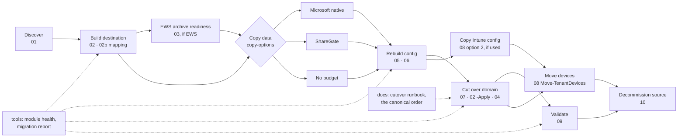

# M365 Tenant-to-Tenant Migration Toolkit

**TL;DR:** Everything I use to move a business from one Microsoft 365 tenant to another, in the order I use it. There's one spine of PowerShell scripts that works whatever moves the data, and three copy options: Microsoft's native cross-tenant migration, ShareGate, or no budget at all. Every script has a README with a TL;DR, why you need it, what goes wrong without it, and the gotchas I hit on a live migration. Built so someone doing their first tenant-to-tenant move can follow it start to finish.

| | |
| --- | --- |
| Author | Mezba Uddin, Microsoft MVP |
| Version | 1.3.0 |
| Licence | MIT |
| Came from | A real small-business migration: mailboxes with large archives, SharePoint, Teams, OneDrive and more than one domain |

## Why this exists

Tenant-to-tenant moves fail in the gaps between tools: the copy tool moves the data, but nobody owns the domain release, the X500 addresses, the DNS host nobody can log in to, or the order it all has to happen in. This toolkit covers those gaps, in order, with a check before every point of no return.

**Without it:** mail bounces for hours on the night, replies to old messages bounce for weeks, and the first sign of a missed step is a phone call from the business owner.

## The journey

| Phase | Part | What it does | Changes anything? |
| --- | --- | --- | --- |
| Discover | [01 Source inventory](01-SourceInventory/) | Mailbox and archive sizes, permissions, users and licences, groups, lists, contacts, domains, SharePoint and OneDrive, as CSVs | No |
| Build | [02 Target mailboxes](02-TargetMailboxes/) | Builds destination mailboxes from the inventory. Stage as shared, copy, then license and convert | Destination. `-WhatIf` |
| Build | [02b User mapping](02b-UserMapping/) | Reads both tenants and matches every mailbox, list and contact (tag, old address, alias, name). Writes the mapping CSV, a ShareGate `.sgum` and a review list. Without it, one typo puts permissions on the wrong person | No |
| Build | [04 Target OneDrives](04-TargetOneDrives/) | Creates destination OneDrives and reports their URLs | Destination. `-WhatIf` |
| Copy | [Copy options](copy-options/) | [A. Microsoft native](copy-options/A-Microsoft-native/), [B. ShareGate](copy-options/B-ShareGate/), [C. No budget](copy-options/C-No-budget/), with a comparison to help you choose | Depends on option |
| Copy | [03 EWS archive readiness](03-EwsArchiveReadiness/) | If your tool copies archives over EWS: checks and fixes both tenants. Without it, mail copies and every archive fails | Only with `-Fix` |
| Rebuild | [05 Mail config](05-MailConfig/) | Permissions, forwarding, distribution lists and contacts, exported and rebuilt. Without it, shared mailboxes arrive that nobody can open | Destination on import. `-WhatIf` |
| Rebuild | [06 Groups, Teams and sites](06-GroupsTeamsSites/) | Every Microsoft 365 group, Team and SharePoint site exported. Groups created in the destination on your domain, with owners and members, before the copy | Destination on import. `-WhatIf` |
| Copy | [New-DriveCopyList](copy-options/#building-the-onedrive-copy-list-new-drivecopylistps1) | Builds the OneDrive copy list for B and C: leavers into one folder each in an archive library, staff into their new OneDrive, archived OneDrives marked Skip. Creates the folders with `-CreateFolders` | Only with `-CreateFolders` |
| Cut over | [07 Domain cutover](07-DomainCutover/) | DNS record, add in destination first, release from source, verify, old addresses with X500s, sign-in names, temporary passwords. Plus `Test-CutoverReadiness` (go/no-go), `Export-DomainDns -FullScan` and `Set-DomainDnsRecords` (moving DNS hosting), `Add-TargetDomain -WaitForDns`, and `Block-SourceSignIn` | Both tenants, in order. `-WhatIf` |
| Cut over | [08 Devices](08-Devices/) | Moves Entra joined laptops (and stand-alone PCs) to the destination with the person's files. [`Move-TenantDevices`](08-Devices/Move-TenantDevices.ps1) option 9 does a laptop **in one go**: one remote session, about 10 minutes, leaves, joins with a bulk enrolment package, restarts, and copies the person's files into their new profile at first sign-in. The same menu builds the package, copies Intune configuration and moves Autopilot hashes. [`Get-DeviceInventory`](08-Devices/Get-DeviceInventory.ps1) lists what you'll touch; [`Export-BitLockerKeys`](08-Devices/Export-BitLockerKeys.ps1) saves recovery keys before anything leaves the source | Destination (Intune, Autopilot) and each laptop. `-WhatIf`. Nothing is wiped |
| Validate | [09 Validation](09-Validation/) | Checks the destination against the inventory, plan and mapping: types, licences, archives, item counts, addresses, X500s, OneDrives, list members, the password-change flag, and Conditional Access that will block your test sign-in. Pass, warn and fail report | No |
| Decommission | [10 Decommission](10-Decommission/) | Block source sign-in, final incrementals, export and retain, unlicensed OneDrives, remove licences, close the tenant. [`Get-DecommissionReadiness`](10-Decommission/Get-DecommissionReadiness.ps1) tells you what still stops you | Read-only script. The closing steps are deliberate and by hand |
| Any time | [tools](tools/) | `Test-ModuleHealth` finds the Graph module version clash before it stops a script. `Get-MigrationReport` reads every report CSV and shows what still needs a look, on screen or as one HTML page | No (`-Fix` installs modules) |
| Plan and run | [docs](docs/) | [Discovery questionnaire](docs/Discovery-Questionnaire.md), [cutover runbook](docs/Cutover-Runbook.md), [comms templates](docs/Comms-Templates.md), [risk register](docs/Risk-Register.md), [handover template](docs/Handover-Template.md), [DNS move playbook](docs/DNS-Move-Playbook.md), [what doesn't move](docs/What-Doesnt-Move.md), [lessons learnt](docs/Lessons-Learnt.md) | No |

The [cutover runbook](docs/Cutover-Runbook.md) is the one canonical order for all of this. The part READMEs follow it.

## Lessons from a live cutover

The domain moved recently. It worked, and it taught me things no lab did: the DNS host wasn't the registrar and nobody could log in to it, guests in the destination were holding the old addresses, a Graph module version clash stopped a script half way, a Conditional Access policy blocked my own test sign-in from another country, and the user mapping had to be rebuilt after cutover. Every one of those is now handled by a script or a check. Read [docs/Lessons-Learnt.md](docs/Lessons-Learnt.md) before you set a date.

## Read this first

1. [Copy options](copy-options/), to decide how the data will move. It changes how you build the destination.
2. [01 Source inventory](01-SourceInventory/) and the [discovery questionnaire](docs/Discovery-Questionnaire.md), to see what you're dealing with.
3. The [cutover runbook](docs/Cutover-Runbook.md), the canonical order, and [07 Domain cutover](07-DomainCutover/), so you know what cutover night looks like before you set a date.
4. [What doesn't move](docs/What-Doesnt-Move.md), so the business knows what it will rebuild itself.
5. [Lessons learnt](docs/Lessons-Learnt.md), and run [tools/Test-ModuleHealth.ps1](tools/) on the PC you'll use.

## How the parts fit together

The short version. The day-by-day version, with every flag, is the [cutover runbook](docs/Cutover-Runbook.md).

1. Run **01** against the source. It writes `Inventory-<tenant>-<date>\` with `04-Mailboxes.csv` and the rest.
2. Choose your copy option. For **Microsoft native**, read its identity note first: it needs mail users in the destination, not mailboxes.
3. Run **02 -Plan** in the same folder, review `TargetBuildPlan.csv`, then **02 -Apply -StageOnly** against the destination.
4. Run **02b** to match every source recipient to its destination. It writes the mapping CSV and a ShareGate `.sgum`. Check its review list line by line.
5. If your tool copies archives over EWS (ShareGate does), run **03** with its app ID and both tenant IDs **before** the mail copy. Then start copying, outside hours.
6. At T-14, run **07 Export-DomainDns -FullScan**. If you can't log in to the DNS host, move DNS hosting now with **Set-DomainDnsRecords**: the name server change needs 48 hours.
7. Before copying Teams or SharePoint, run **06 -Export** and **06 -Import**, so the groups exist on the right domain with their members. Then copy into them.
8. Run **05 -Export** against the source and **05 -Import** against the destination, so shared mailboxes, lists and forwarding work on day one. When licences arrive, **02 -Apply -SharedMailboxesOnly**.
9. At T-7, **07 Remove-SourceDomain -BlockersOnly** and clear what it finds.
10. The day before (T-1), take the `-pre` snapshot with **07 Remove-SourceDomain -SnapshotOnly**, then run **07 Test-CutoverReadiness** with it. On the night, take a fresh snapshot and do a final readiness run just before the rollback point.
11. On cutover night, follow the runbook: add the domain to the destination and publish its TXT, snapshot, readiness, release with `-FixApplications`, verify, **02 -Apply** to license and convert, **Switch-TargetAddresses**, then **04** so the OneDrives exist.
12. Run **09** after the copy, on cutover night and a few days later. Attach the last report to the handover, with the HTML from **tools/Get-MigrationReport**.
13. The day after, **07 Block-SourceSignIn**, then rebuild the mapping with **02b** before any incremental. Copy OneDrive from the list **New-DriveCopyList** builds, now sign-in names are final.
14. Devices with **08 Move-TenantDevices**. At T-7, check whether the source uses Intune at all; if it does, copy its configuration with option 2 (`-WhatIf` first) before any laptop moves. After cutover, build the enrolment package (option 1) on your admin PC. Copy each person's OneDrive, then move their laptop with option 9 (`-Action MoveInOneGo -SourceTenantId`), in their own session, on that laptop only. Finish before the source licences end. Then work through the owner-recreates list in [What doesn't move](docs/What-Doesnt-Move.md).
15. When the business signs off, close the source with **10**, never before the final incrementals or the licence overlap ends.

**tools** runs alongside all of it: **Test-ModuleHealth** before you start and on the cutover PC, **Get-MigrationReport** after every step on the night.

One mapping file (`Source,Destination`: old address to new sign-in) drives 05, 06, 07, 09, and the user mapping in whichever copy tool you use. Build it with [02b](02b-UserMapping/) after 02, and again after cutover, because sign-in names change.

## Things that apply everywhere

**Two tenants, one PC.** You'll be signed in to two tenants from the same machine for weeks. Windows quietly reuses your last sign-in, so `Connect-ExchangeOnline` or `Connect-MgGraph` can land you in the wrong tenant without asking. The scripts that change things check the tenant ID first, and take `-AdminUpn`: name the account and they disconnect any other session, sign in as it, and print "Signed in as X to tenant Y" before changing anything. When you run commands by hand, name the account (`-UserPrincipalName`) or the tenant (`-TenantId`), and check `Get-ConnectionInformation` before anything destructive.

**One module version, one fresh window.** Install every Microsoft.Graph module at the same version, and run each task in a fresh PowerShell window. ShareGate's module only loads in Windows PowerShell 5.1; everything else here runs in 7. [tools/Test-ModuleHealth.ps1](tools/) checks all of it.

**EWS ends on 1 April 2027.** Tools and scripts that copy archives over EWS stop working then. Move big archives before it.

**The output is sensitive.** The CSVs hold names, addresses, permissions and, from some steps, temporary passwords. The `.gitignore` keeps them out of commits. Keep them out of email and shared drives too.

**What this doesn't move:** Teams chats, Planner, Forms, Power Platform, Bookings, Teams Phone, Conditional Access and other tenant settings. Intune policies do move, with 08 option 2; Win32 and LOB app installers, saved browser passwords and Windows Hello don't. Rebuild those deliberately; don't copy a mess. [What doesn't move](docs/What-Doesnt-Move.md) lists each one, with the owner-recreates checklist and three ways to handle it.

## Disclosure

Not sponsored by anyone. Where I name a product, it's because I used it on the job.

## Older links

This repo used to be called M365-PreMigration-Inventory. GitHub redirects the old URL here. The inventory script now lives in [01-SourceInventory](01-SourceInventory/).

## Changelog

| Version | Date | Change |
| --- | --- | --- |
| 1.4.0 | 2026-11-13 | 08: option 9 moves a laptop in one go (files copied at first sign-in); stand-alone PCs too. `copy-options/B-ShareGate/Copy-PeopleOneDrives.ps1` finds OneDrive URLs by owner in both tenants. Phase 1 of the live job closed |
| 1.3.0 | 2026-11-10 | 08 is now scripted end to end: `Move-TenantDevices` (package, Intune configuration copy, Autopilot, staged laptop move, profile handover) in the parts table, diagram and "How the parts fit". Intune policies no longer listed as not moving |
| 1.2.0 | 2026-11-10 | Diagram and "How the parts fit" include 02b, 03, 08, 10 and tools. Points at the cutover runbook as the canonical order. Readiness at T-1 plus a final run on the night. What doesn't move added |
| 1.1.0 | 2026-11-10 | Lessons from a live cutover, tools, 07 readiness and DNS scripts |
| 1.0.0 | 2026-11-09 | First release |
